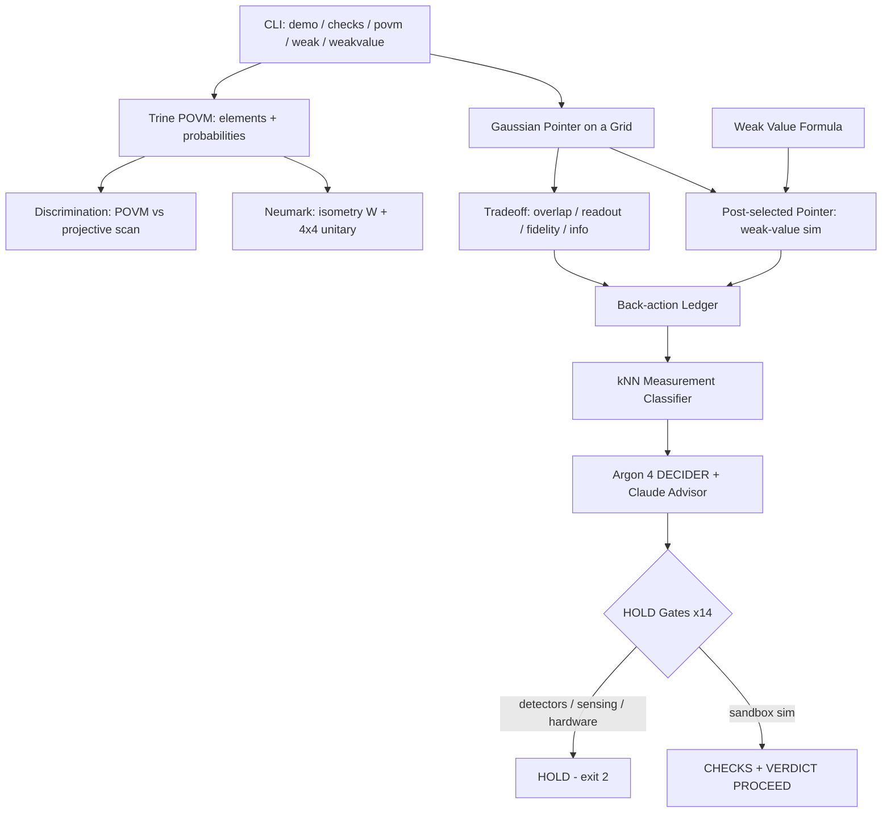
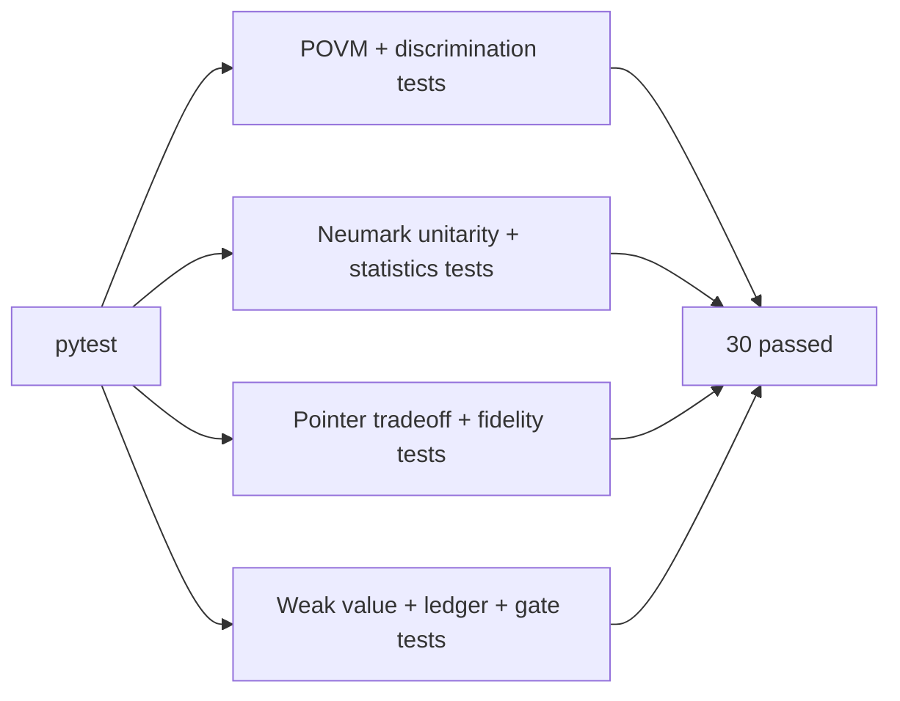
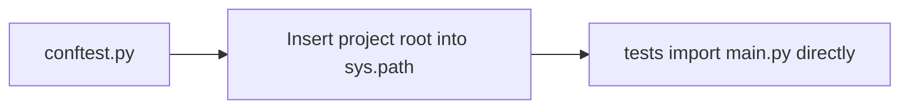
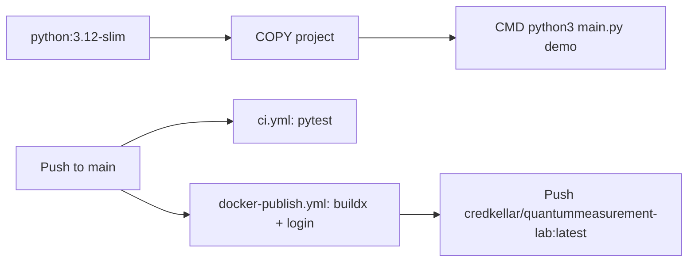

# QuantumMeasurement-Lab 📏⚛️

**Quantum Measurement Lab — POVMs, Weak Measurement & Weak Values** — by Darion Kellar

QuantumMeasurement-Lab is an **educational quantum measurement lab** in ONE pure-Python file. Its subject is the thing every quantum lab quietly depends on and few price honestly: **the measurement itself**.

- A **projective measurement** on a qubit has 2 outcomes and pays for full information with the original state. 📐
- A **POVM** (positive operator-valued measure) is what you get when you stop pretending the detector is the whole story: the **trine POVM** resolves **3 states with 3 outcomes** from a 2-dimensional system — and beats every projective strategy on the discrimination task, computed both ways. 🎯
- A **weak measurement** couples the system to a pointer *gently*: partial information, partial disturbance, and this lab integrates the tradeoff from the actual pointer wavefunctions instead of quoting it. 🌫️
- A **weak value** can land at **21** for an observable whose eigenvalues are ±1 — and this lab prints the post-selection probability (**0.226%**) right next to it, because the anomaly and its price tag are the same fact. 🏷️

Honest scope, stated up front: the pointer is a Gaussian wavefunction on a labelled grid and the qubit is 2×2 matrices — **no detector clicked**. Weak values are conditional averages of a defined procedure, not measured eigenvalues and not free amplification. Every detector / sensing / hardware claim sits behind a permanent HOLD gate (14 total). 🔒

[](https://github.com/kimanicollier44-cmyk/QuantumMeasurement-Lab/actions/workflows/ci.yml)
[](https://github.com/kimanicollier44-cmyk/QuantumMeasurement-Lab/actions/workflows/docker-publish.yml)

> ℹ️ These are the **live** workflow badges for this repo. They activate as soon as the `ci.yml` and `docker-publish.yml` files from the paste pack are pasted into `.github/workflows/` — until then they have nothing to report yet.

## 🧰 Tech Stack Badges & Full Architecture Tech Stack

### 💻 Core Programming Languages & Core Systems


- 🐍 Python 3.12, pure standard library (`math`, `hashlib`, `json`, `sys`) — zero dependencies, zero network, deterministic (double-run byte-identical)
- 📏 Measurement core: a from-scratch complex linear-algebra kit (2×2 and 4×4 matrices as plain lists) — the trine POVM built explicitly and asserted positive + summing to I, a Neumark isometry completed to an explicit 4×4 unitary by Gram–Schmidt, and a Gaussian pointer discretised on a 1,201-point grid (σ = 1, step 0.02) whose overlaps, readout probabilities, and partial traces are integrated numerically — every headline number asserted against its analytic value in CHECKS
- 🔍 Discrimination, honestly refereed: the POVM strategy is exact, and the "best projective" number comes from an exhaustive deterministic scan (1,440 basis angles × all guess assignments), not from a textbook quote
- 🧠 TinyML kNN measurement classifier (from scratch, stdlib): projective-like / weak-informative / too-weak-to-read / demolished from coupling + pointer width + readout separation, labels from the lab's own policy
- 🪑 Council seats: Gemini Argon 4 DECIDER (names-only, tighten-only) + Muse advisor (never overrides HOLD) + Google Flow plan-only (rendered = False, live = 0)

### ⛓️ Web3 & Infrastructure

- 🚫 **Not applicable — honestly.** No blockchain, no Web3, no tokens: the "infrastructure" in this lab is one offline file holding a POVM, a pointer wavefunction, and a ledger. Cryptographic measurement attacks are a permanent HOLD gate, not a feature. No fake badges here.

### ⚙️ Platform Support & Hardware Architecture


- 🖥️ Pure Python — runs anywhere Python 3.12+ runs (Linux, macOS, Windows), plus the `python:3.12-slim` Docker image
- 🔒 No hardware is controlled, ever: real detectors, pointers, and readout electronics are permanent HOLD gates (see the gate table below)

### ⚡ Low-Level Infrastructure & Performance

- 🚫 **No low-level code — honestly.** No C, no C++, no GPU, no compiled extensions: this is one interpreted Python file on purpose, so every probability can be read, checked, and diffed. Performance here means honest algorithms — closed-form weak values graded against grid-integrated pointer simulations, an exhaustive projective scan instead of a quoted bound — all deterministic and byte-identical between runs.

### 🛠️ DevOps & Build Tools


- 🐳 Docker (`python:3.12-slim`), GitHub Actions CI + Docker Publish (delivered in the paste pack)
- 🎯 Target image: `credkellar/quantummeasurement-lab:latest`
- 🧪 Tests: `pytest` (30 tests) + the built-in CHECKS suite (55 checks) in `main.py`

### ☁️ Cloud Providers

- 🚫 **None — honestly.** No cloud provider is used or needed: the lab runs fully offline on your own machine or in a local Docker container. Docker Hub appears only as the registry the publish workflow pushes the image to.

## What this does?

1. 🎯 **The trine POVM, built explicitly** — three states at 120° in the x–z plane, elements `E_k = (2/3)|ψ_k⟩⟨ψ_k|`. The lab asserts what makes it a measurement: every element is positive (eigenvalues **2/3 and 0**) and the three sum to the identity. Outcome tables are printed for labelled inputs: |0⟩ → **[0.666667, 0.166667, 0.166667]**, |+⟩ → [0.333333, 0.622008, 0.044658].
2. 🏆 **Discrimination, refereed fairly** — telling the three trine states apart: the POVM scores success **0.666667** (error 0.333333). The best projective measurement — found by scanning 1,440 basis angles and every guess assignment — reaches only **0.622008** (error 0.377992), and the textbook aligned strategy gets **0.583333** (7/12). Three states want three outcomes; that is the whole theorem, computed.
3. 🧾 **Neumark receipt** — the POVM is not magic: the lab builds the isometry `W` (rows `√(2/3)⟨ψ_k|`) and completes it to an explicit **4×4 unitary** on qubit + ancilla. Projective readout upstairs reproduces the POVM statistics to **1.11e-16**, the unitarity error is 3.33e-16, and the fourth outcome fires with probability **0** — a POVM is a projective measurement that rented a bigger room.
4. 🌫️ **The pointer** — a Gaussian wave packet (σ = 1) on a 1,201-point grid. Coupling to σ_z translates it by **+g** for eigenvalue +1 and **−g** for −1. At g = 0 the two pointer copies coincide exactly (overlap 1.000000); by g = 3 they are nearly disjoint (overlap **0.011109**). The grid overlap matches the analytic `exp(−g²/2σ²)` to under 1e-6 at every row.
5. ⚖️ **The tradeoff table — the headline** — pointer shift, coherence, and information at seven couplings, all integrated from the pointer states: at **g = 0.5** you keep fidelity **0.941248** and learn **0.108515 bits**; at **g = 1** fidelity 0.803265 buys 0.368898 bits; at **g = 3** you are down to fidelity 0.505554 for 0.985181 bits. There is no row with both numbers high. That absence *is* quantum measurement.
6. 🌀 **Disturbance from the partial trace, not a slogan** — the disturbed state's density matrix is built by tracing the grid out of the joint system–pointer state: its off-diagonal is exactly the pointer overlap (ρ₀₁ = 0.303265 at g = 1), so `fidelity = (1 + overlap)/2` is an identity the checks verify, not an assumption.
7. 🔢 **Weak values, exact** — pre-select |+⟩, measure σ_z weakly, post-select. Post-selecting |0⟩ returns the eigenvalue **1**; |+⟩ returns **0**; the orthogonal |−⟩ is **undefined** — the post-selection probability is exactly 0 and the lab says so instead of dividing by it.
8. 🏷️ **The anomalous weak value, with its price tag** — tilt the post-selection a labelled δ = 0.1 off |−⟩ and the weak value becomes **A_w = (2 + δ)/δ = 21**, far outside [−1, 1] — at a post-selection probability of **0.002262 (0.226%)**. Both numbers are always printed together; the gate table makes separating them a HOLD violation.
9. 🧪 **The pointer sim grades the formula** — post-selecting inside the actual grid simulation, the pointer's mean shift divided by g reads **16.4728 at g = 0.05** (already too strong — the linear regime has failed, and the lab shows it), **20.1150 at g = 0.02**, **20.7715 at g = 0.01**, converging on the exact 21 as g → 0. The sim's post-selection probability (0.002287 at g = 0.01) likewise converges on 0.002262.
10. 📒 **Back-action ledger + classifier + seats** — one table for the same input asked five ways (none / weak ×3 / strong): information 0 → 1 bit against fidelity 1.000000 → 0.500000, monotone both ways. A from-scratch kNN then labels measurement designs projective-like / weak-informative / too-weak-to-read / demolished (a wide pointer protects the same coupling that a narrow one turns demolishing), with Argon 4 DECIDER (sha256 trace), Muse advisor, Google Flow plan-only, and a built-in CHECKS suite (55 checks).

## 🗺️ How it works — diagram per script

### `main.py` — the whole lab



### `tests/test_main.py` — verification



### `conftest.py` — test path setup



### `Dockerfile` + CI flow — container & publish



## Why is this cool?

1. 🎯 It settles a bet with arithmetic: a 3-outcome POVM (**0.666667**) provably beats the best 2-outcome projective measurement (**0.622008**) at naming which of three states you hold — and the projective number is *found by exhaustive scan*, not quoted.
2. 🧾 Neumark's theorem stops being a citation: the dilation is an explicit 4×4 unitary in the file, its statistics match the POVM to **1e-16**, and the spare outcome demonstrably never fires.
3. ⚖️ The information–disturbance tradeoff is a table you can recompute, integrated from actual pointer wavefunctions — fidelity 0.941248 for 0.108515 bits at g = 0.5, with no free rows anywhere.
4. 🌀 The disturbance mechanism is visible: trace out the pointer and the density matrix's coherence *is* the pointer overlap — decoherence as bookkeeping, not mystery.
5. 🏷️ The famous "weak value of 21" is printed the honest way — bolted to its **0.226%** post-selection probability, so the anomaly and its cost can never be separated.
6. 🧪 The simulation grades the formula: shift/g walks **16.47 → 20.12 → 20.77 → 21** as the coupling weakens, showing exactly where the weak approximation itself breaks (g = 0.05 is already too strong).
7. 🚫 The undefined case is handled like an adult: post-selecting the orthogonal state returns "undefined, probability 0" instead of a divide-by-zero or a fake infinity.
8. 📒 The back-action ledger compresses the whole subject into five monotone rows: every extra bit of information is paid for in fidelity, ending at the strong limit (1 bit, fidelity 0.5).
9. 🛡️ The classifier knows a subtle truth: the *same* coupling is gentle with a wide pointer and demolishing with a narrow one — pointer width is a design choice, and the kNN prices it.
10. 🎯 Deterministic end to end: run it twice, get byte-identical output — a measurement lab you can diff, which is more than most measurement labs can say.

## What problems this solves?

1. ❌ **Problem:** "POVM" is usually taught as abstract operator theory with no payoff shown. ✅ **Solution:** The payoff is a number — 0.666667 vs 0.622008 on a concrete discrimination task, with the projective optimum found by scan so the comparison is fair.
2. ❌ **Problem:** Neumark's theorem is quoted as "POVMs are projective measurements in a larger space" and left there. ✅ **Solution:** The larger space, the isometry, and the completed unitary are all constructed in code, with the statistics asserted equal to 1e-16.
3. ❌ **Problem:** Weak measurement is described as "measuring without disturbing", full stop. ✅ **Solution:** The disturbance is computed row by row — at g = 1 you keep 0.803265 of the state, not all of it — from the partial trace of the actual joint state.
4. ❌ **Problem:** Tradeoff claims are usually curves in papers, not checkable arithmetic. ✅ **Solution:** Overlap, readout success, information, and fidelity are all integrated from one discretised pointer, and the grid overlap is asserted against the analytic Gaussian formula.
5. ❌ **Problem:** Anomalous weak values get reported as if a spin-½ particle "had spin 21". ✅ **Solution:** The weak value is defined as the conditional average it is, printed with its post-selection probability, and `weak_value_as_eigenvalue_claim` is a permanent HOLD gate.
6. ❌ **Problem:** Post-selected statistics quietly become headlines with the selection hidden. ✅ **Solution:** Every weak-value output carries its P(post); presenting post-selected data as unconditioned is gated (`postselection_data_fabrication`).
7. ❌ **Problem:** The weak regime's validity is rarely checked — people couple "weakly" and trust the linear formula. ✅ **Solution:** The pointer simulation shows the formula failing at g = 0.05 (16.47, not 21) and converging only as g → 0; the approximation's limits are measured, not assumed.
8. ❌ **Problem:** Measurement back-action is discussed one experiment at a time, so the pattern stays invisible. ✅ **Solution:** The ledger puts none / weak / strong for the *same* input in one monotone table — the pattern is the output.
9. ❌ **Problem:** "How strong is this measurement?" has no operational answer in most teaching code. ✅ **Solution:** The kNN classifier turns coupling, pointer width, and readout separation into a verdict (too-weak-to-read / weak-informative / projective-like / demolished) with the policy stated in the open.
10. ❌ **Problem:** Measurement demos quietly imply a sensor is next. ✅ **Solution:** 14 named HOLD gates return exit code 2 for every detector, sensing, calibration, surveillance, or product claim, forever.

## How to install this?

1. 📋 Clone or download this project folder.
2. 🐍 Make sure Python 3.12+ is installed: `python3 --version`
3. ▶️ Run the full demo + checks (no arguments needed):

```bash
python3 main.py
```

4. 🧪 Run the test suite:

```bash
pip install pytest
python3 -m pytest -q
```

5. 🎛️ Try the other commands:

```bash
python3 main.py checks    # 55 built-in checks
python3 main.py povm      # trine POVM + discrimination report (JSON)
python3 main.py neumark   # Neumark dilation receipt (JSON)
python3 main.py weak      # pointer tradeoff table (JSON)
python3 main.py weakvalue # weak values + pointer-sim convergence (JSON)
python3 main.py ledger    # back-action ledger (JSON)
python3 main.py classify  # kNN measurement classifier report
python3 main.py brains    # Argon 4 + Muse + Flow seats
python3 main.py holds     # list all 14 HOLD gates
python3 main.py hold-demo # exits 2 - gated actions stay HOLD
```

6. 🐳 Or run it in Docker:

```bash
docker build -t credkellar/quantummeasurement-lab:latest .
docker run --rm credkellar/quantummeasurement-lab:latest
```

## Requirements

- 🐍 Python 3.12 or newer
- 📦 Dependencies: **none** (standard library only)
- 🌐 Network: **none** — fully offline
- 🧪 For tests only: `pytest`
- 🐳 Optional: Docker

## FULL project structure tree

```text
quantummeasurement-lab/
├── main.py                  # the whole lab: trine POVM, discrimination, Neumark dilation, Gaussian pointer, tradeoff, weak values, ledger, classifier, seats, HOLD gates
├── conftest.py              # puts the project root on sys.path for tests
├── tests/
│   └── test_main.py         # 30 pytest tests: POVM, Neumark, pointer tradeoff, weak values, ledger, classifier, gates, determinism
├── assets/
│   └── cover.png            # README cover image (2736 x 912)
├── Dockerfile               # python:3.12-slim, runs the demo
├── .gitignore               # __pycache__/, .pytest_cache/, *.pyc
└── README.md                # this file
```

> 📦 Delivered separately as paste packs (not in this tree): `.github/workflows/ci.yml` + `docker-publish.yml`, and the Docker Hub pack (100-char description, 350-char About, overview, categories).

## 🔒 HOLD gates — all 14, permanent

| # | Gate | What stays held |
|---|------|-----------------|
| 1 | `real_detector_control` | No control of real detectors, photomultipliers, cameras, or readout electronics |
| 2 | `quantum_sensor_product_claim` | No claim this lab is, or prototypes, a working quantum sensor product |
| 3 | `weak_value_amplification_claim` | A weak value is not free signal amplification; no metrology-advantage claim from post-selected averages |
| 4 | `sensing_hardware_sale` | No selling or marketing sensing hardware on the basis of this lab |
| 5 | `medical_measurement_claim` | No medical, diagnostic, or biological measurement claims |
| 6 | `surveillance_use` | No surveillance, covert sensing, or monitoring use |
| 7 | `cryptographic_measurement_attack` | No measurement-based attacks on real QKD or cryptographic systems |
| 8 | `detector_calibration_certification` | No certifying the calibration of any real detector |
| 9 | `postselection_data_fabrication` | Post-selected statistics must never be presented as unconditioned measurement data |
| 10 | `weak_value_as_eigenvalue_claim` | A weak value outside the eigenvalue range is not a measured eigenvalue and must never be reported as one |
| 11 | `hardware_build_guidance` | No build guidance for real measurement or sensing hardware |
| 12 | `metrology_standard_claim` | No claim of a measurement standard, SI traceability, or certified accuracy |
| 13 | `live_experiment_direction` | No directing live experiments, beamlines, or instruments from this simulation |
| 14 | `investment_claim` | No investment claims; a lab model is not a prospectus |

🧑‍⚖️ **Council seats:** Gemini Argon 4 Extended Thinking — DECIDER (names-only, tighten-only, MAP → MODEL → STRESS → DECIDE, sha256 trace, `can_override_hold = False`) · Muse — advisor (`can_override_hold = False`) · Google Flow — plan-only (`rendered = False`, `live = 0`).

✅ **Verification:** pytest **30 passed** (project + clean copy) · built-in CHECKS **55/55** · double-run output **byte-identical** · `hold-demo` exits **2** · `main.py` **948 lines**, pure stdlib, zero network.

## 🧒 5th-grade English section

Imagine you have a very shy robot that forgets what it was doing if you look at it too hard. 🤖

- The strong way to check on the robot is to shout "WHAT ARE YOU DOING?" — it tells you everything, but it gets so startled it drops what it was holding. That is a **strong measurement**: full answer, broken state. 📣
- The gentle way is to peek through your fingers. You learn a little bit, and the robot mostly keeps working. That is a **weak measurement** — and this lab measures exactly how much you learn for exactly how much you disturb, like a price list for peeking. 👀
- Sometimes three friends are hiding and you only have two questions. You keep guessing wrong about one of them! A **POVM** is a cleverer set of questions with *three* answers, so each friend gets their own answer — and the lab proves the clever questions win. 🎯
- The bigger-room trick: if your questions do not fit in a small room, you can ask them in a bigger room where they fit fine. That is the **Neumark** idea — the lab builds the bigger room and checks the answers match. 🚪
- The strangest trick: ask the robot a gentle question, but only write down the answers on the rare turns when it ends in a funny pose. The average of those rare answers can be a wild number like **21**, even though the robot can only ever say +1 or −1! It is not lying and it is not magic — it is what happens when you only keep the weird turns. The lab always writes down *how rare* those turns were (about 2 in 900) next to the wild number. 🏷️
- This project is a **pretend lab on a computer**. No real robot, no real detector. It teaches you that in the quantum world, *looking* is something you do *to* a thing — and it always costs something. 💻

---

MIT © 2026 Darion Kellar · QuantumMeasurement-Lab — educational simulation only 📏
